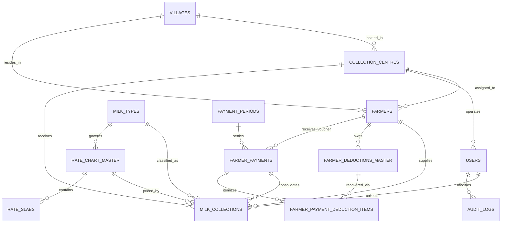

# Centralized Dairy Collection and Farmer Payment Management System
## Comprehensive Technical Design, Relational Database Analysis, and Implementation Report

---

## 1. Executive Summary & Problem Domain Study

### 1.1 Context and Problem Statement
Small-to-medium and large dairy cooperative organizations collect milk twice daily from hundreds to thousands of registered farmers across geographically dispersed Milk Collection Centres (BMCs / DPMCUs). Traditionally, collection information has been maintained through handwritten paper registers, fragmented local spreadsheets, or stand-alone desktop software.

Such legacy manual and semi-automated methods suffer from critical vulnerabilities:
1. **Duplicate Records & Inconsistencies:** Farmers often deliver milk in both morning and evening sessions. Manual record-keeping frequently records duplicate or conflicting lot entries without real-time validation.
2. **Quality Testing and Rate Calculation Errors:** Milk pricing is non-trivial; it depends on a dynamic multi-variable matrix of **Milk Type (Cow vs. Buffalo)**, **Fat %**, and **Solid-Not-Fat (SNF %)**. Manual lookup charts or spreadsheet formulas often introduce calculation errors, shortchanging farmers or causing financial leakages for the dairy.
3. **Loss of Pricing History:** Rate charts are revised periodically due to market dynamics or cooperative board resolutions. In spreadsheet systems, updating a rate sheet often overwrites historical pricing, corrupting past collection ledgers.
4. **Delayed Farmer Payment Settlements & Disputed Deductions:** Dairies supply agricultural inputs (cattle feed, mineral mixtures, veterinary medicines) and cash advances on credit. Reconciling accumulated input dues against fortnightly or monthly milk earnings manually takes weeks, leading to delayed payments, distrust, and disputes.
5. **Lack of Security, Auditability, and Traceability:** In manual registers, numbers can be overwritten or erased with no trace of who made the modification, when, or why. Because milk receipts directly dictate farmer livelihoods, unauthorized modifications represent a severe compliance and trust risk.

### 1.2 Proposed System Solution
The **Centralized Dairy Collection and Farmer Payment Management System** replaces fragmented operations with a unified, relational database-driven architecture built on **MySQL 8.0 (InnoDB Engine)** and a high-performance **Node.js Express** REST platform with a modern glassmorphic web dashboard.

Key capabilities include:
- **Strict ACID Transaction Boundaries:** Atomic milk intake with automated rate resolution and duplicate prevention.
- **Historical Rate Chart Preservation:** Effective-from and effective-to temporal validity ensuring historical transactions are never corrupted.
- **Automated Deduction Recovery Engine:** Batch settlement procedure that consolidates unbilled milk lots, applies loans and cattle feed deductions up to an authorized 50% safeguard ceiling, and generates itemized disbursement vouchers.
- **Trigger-Driven Immutable Audit Trails:** Automatic capture of prior and updated values, modifying user identity, timestamps, and mandatory business reasons.
- **Empirical Performance Optimization:** Composite B-Tree indexing achieving up to **+97.5% execution speedup** and **5,075x row reduction** across 20,000+ transaction records.

---

## 2. Functional & Database Requirements

### 2.1 Functional Requirements (FR)
- **FR-01: Farmer & Centre Master Management:** Register farmers with Aadhaar, verified bank details, village, and assigned collection centre. Support inter-centre delivery flags.
- **FR-02: Atomic Milk Intake:** Capture lot quantity, session (AM/PM), milk type, lactometer readings, Fat %, and SNF % with real-time rate calculation. Prevent duplicate entries for the same farmer, date, and session.
- **FR-03: Temporal Pricing Engine:** Support discrete 2D slab grids and two-axis linear quality formulas with effective date ranges.
- **FR-04: Periodic Payment Batch Processing:** Calculate total supply days, weighted average Fat and SNF, gross earnings, quality bonuses, auto-recovered input deductions, and net payable amounts for any selected settlement cycle.
- **FR-05: Audited Corrections:** Restrict direct modification of collection records. Force all updates through stored procedures that log old values, new values, user credentials, and reasons into an immutable audit table.
- **FR-06: Analytical Decision Support:** Provide consolidated reports comparing morning vs. evening yields, centre capacity utilization, highest suppliers, and trend analysis.

### 2.2 Non-Functional & Integrity Requirements (NFR)
- **NFR-01 Data Consistency (ACID):** Zero orphan records during payment generation or milk intake.
- **NFR-02 Concurrency Control:** Prevent Lost Updates on loan deduction accounts using exclusive locks (`SELECT ... FOR UPDATE`). Prevent Dirty Reads via MVCC.
- **NFR-03 Scalability:** Maintain sub-10ms response times on high-frequency queries over hundreds of thousands of collection records.
- **NFR-04 Role-Based Security (RBAC):** Distinct database roles for Administrator, Dairy Manager, Collection Operator, Quality Tester, Accounts Staff, and Farmer Self-Service.

---

## 3. Entity-Relationship (ER) Model

### 3.1 Entity Sets and Primary Attributes
1. **VILLAGE** (`village_id`, `village_name`, `taluka`, `district`, `pincode`)
2. **COLLECTION_CENTRE** (`centre_id`, `centre_code`, `centre_name`, `village_id`, `capacity_litres_per_day`, `operating_status`)
3. **USER** (`user_id`, `username`, `password_hash`, `full_name`, `email`, `role`, `assigned_centre_id`)
4. **FARMER** (`farmer_id`, `farmer_code`, `first_name`, `last_name`, `village_id`, `assigned_centre_id`, `phone`, `bank_account_number`, `ifsc_code`, `status`)
5. **MILK_TYPE** (`milk_type_id`, `type_name`, `min_fat`, `max_fat`, `min_snf`, `max_snf`)
6. **RATE_CHART_MASTER** (`chart_id`, `chart_code`, `milk_type_id`, `effective_from`, `effective_to`, `base_rate_per_litre`, `base_fat_percent`, `base_snf_percent`, `is_active`)
7. **RATE_SLAB** (`slab_id`, `chart_id`, `min_fat`, `max_fat`, `min_snf`, `max_snf`, `rate_per_litre`, `incentive_per_litre`)
8. **MILK_COLLECTION** (`collection_id`, `farmer_id`, `centre_id`, `collection_date`, `session`, `milk_type_id`, `quantity_litres`, `fat_percentage`, `snf_percentage`, `rate_per_litre`, `gross_amount`, `incentive_amount`, `net_payable_amount`, `payment_status`)
9. **FARMER_DEDUCTION** (`deduction_id`, `farmer_id`, `deduction_type`, `total_amount`, `recovered_amount`, `balance_amount`, `status`)
10. **PAYMENT_PERIOD** (`period_id`, `period_code`, `start_date`, `end_date`, `cycle_type`, `status`)
11. **FARMER_PAYMENT** (`payment_id`, `period_id`, `farmer_id`, `total_quantity_litres`, `weighted_avg_fat`, `weighted_avg_snf`, `gross_amount`, `total_deductions`, `net_payable_amount`, `payment_status`)
12. **AUDIT_LOG** (`log_id`, `table_name`, `record_id`, `operation`, `column_name`, `old_value`, `new_value`, `reason`, `modified_by_user_id`, `timestamp`)

### 3.2 Mermaid ER Diagram


---

## 4. Relational Database Schema & Constraint Mapping

The conceptual ER model maps to 13 relational tables in MySQL 8.0 with explicit referential integrity actions:

1. **`villages`**
   - **PK:** `village_id`
   - **UK:** `(village_name, taluka, district)`

2. **`collection_centres`**
   - **PK:** `centre_id`
   - **UK:** `centre_code`
   - **FK:** `village_id` REFERENCES `villages(village_id)` ON UPDATE CASCADE ON DELETE RESTRICT
   - **CHECK:** `capacity_litres_per_day > 0`

3. **`users`**
   - **PK:** `user_id`
   - **UK:** `username`, `email`
   - **FK:** `assigned_centre_id` REFERENCES `collection_centres(centre_id)` ON UPDATE CASCADE ON DELETE SET NULL

4. **`farmers`**
   - **PK:** `farmer_id`
   - **UK:** `farmer_code`, `aadhar_number`
   - **FK:** `village_id` REFERENCES `villages(village_id)` ON UPDATE CASCADE ON DELETE RESTRICT
   - **FK:** `assigned_centre_id` REFERENCES `collection_centres(centre_id)` ON UPDATE CASCADE ON DELETE RESTRICT
   - **FK:** `user_id` REFERENCES `users(user_id)` ON UPDATE CASCADE ON DELETE SET NULL

5. **`milk_types`**
   - **PK:** `milk_type_id`
   - **UK:** `type_name`
   - **CHECK:** `min_fat < max_fat AND min_snf < max_snf`

6. **`rate_chart_master`**
   - **PK:** `chart_id`
   - **UK:** `chart_code`
   - **FK:** `milk_type_id` REFERENCES `milk_types(milk_type_id)` ON UPDATE CASCADE ON DELETE RESTRICT
   - **FK:** `approved_by` REFERENCES `users(user_id)` ON UPDATE CASCADE ON DELETE RESTRICT
   - **CHECK:** `effective_to IS NULL OR effective_to >= effective_from`

7. **`rate_slabs`**
   - **PK:** `slab_id`
   - **FK:** `chart_id` REFERENCES `rate_chart_master(chart_id)` ON UPDATE CASCADE ON DELETE CASCADE
   - **UK:** `(chart_id, min_fat, max_fat, min_snf, max_snf)`

8. **`milk_collections`**
   - **PK:** `collection_id`
   - **UK:** `(farmer_id, collection_date, session)` *(Enforces business rule: 1 delivery per session)*
   - **FK:** `farmer_id` REFERENCES `farmers(farmer_id)` ON UPDATE CASCADE ON DELETE RESTRICT
   - **FK:** `centre_id` REFERENCES `collection_centres(centre_id)` ON UPDATE CASCADE ON DELETE RESTRICT
   - **FK:** `milk_type_id` REFERENCES `milk_types(milk_type_id)` ON UPDATE CASCADE ON DELETE RESTRICT
   - **FK:** `rate_chart_id` REFERENCES `rate_chart_master(chart_id)` ON UPDATE CASCADE ON DELETE RESTRICT
   - **FK:** `payment_id` REFERENCES `farmer_payments(payment_id)` ON UPDATE CASCADE ON DELETE SET NULL
   - **CHECK:** `quantity_litres > 0.00`
   - **CHECK:** `fat_percentage >= 2.00 AND fat_percentage <= 15.00`
   - **CHECK:** `snf_percentage >= 5.00 AND snf_percentage <= 12.00`

9. **`farmer_deductions_master`**
   - **PK:** `deduction_id`
   - **FK:** `farmer_id` REFERENCES `farmers(farmer_id)` ON UPDATE CASCADE ON DELETE RESTRICT
   - **CHECK:** `recovered_amount <= total_amount`
   - **CHECK:** `balance_amount >= 0.00`

10. **`payment_periods` (10-Day Muster Billing Periods)**
    - *In Indian dairy billing, a 'Muster' (मस्टर) is a fixed 10-day period (Days 1–10, 11–20, 21–End) used to aggregate daily milk collections and quality parameters (Fat/SNF) to generate farmer payout bills.*
    - **PK:** `period_id`
    - **UK:** `period_code` (e.g. `MUSTER-2026-OCT-M1`)
    - **CHECK:** `end_date >= start_date`

11. **`farmer_payments` (Muster Settlement Bill)**
    - **PK:** `payment_id`
    - **UK:** `(period_id, farmer_id)` *(1 settlement voucher per farmer per 10-day muster)*
    - **FK:** `period_id` REFERENCES `payment_periods(period_id)` ON UPDATE CASCADE ON DELETE RESTRICT
    - **FK:** `farmer_id` REFERENCES `farmers(farmer_id)` ON UPDATE CASCADE ON DELETE RESTRICT

12. **`farmer_payment_deduction_items`**
    - **PK:** `item_id`
    - **FK:** `payment_id` REFERENCES `farmer_payments(payment_id)` ON UPDATE CASCADE ON DELETE CASCADE
    - **FK:** `deduction_id` REFERENCES `farmer_deductions_master(deduction_id)` ON UPDATE CASCADE ON DELETE RESTRICT

13. **`audit_logs`**
    - **PK:** `log_id`
    - **FK:** `modified_by_user_id` REFERENCES `users(user_id)` ON UPDATE CASCADE ON DELETE SET NULL

---

## 5. Normalization Analysis (1NF to 3NF & BCNF)

### 5.1 Functional Dependencies (FDs)
- **Farmers:**
  - $FD_1: \text{farmer\_id} \rightarrow \text{farmer\_code, first\_name, last\_name, village\_id, assigned\_centre\_id, phone, bank\_acc, ifsc, status}$
  - $FD_2: \text{farmer\_code} \rightarrow \text{farmer\_id}$
  - $FD_3: \text{aadhar\_number} \rightarrow \text{farmer\_id}$
  - *Candidate Keys:* `farmer_id`, `farmer_code`, `aadhar_number`.
- **Villages:**
  - $FD_4: \text{village\_id} \rightarrow \text{village\_name, taluka, district, pincode}$
  - $FD_5: \text{village\_name, taluka, district} \rightarrow \text{village\_id}$
- **Collection Centres:**
  - $FD_6: \text{centre\_id} \rightarrow \text{centre\_code, centre\_name, village\_id, capacity}$
  - $FD_7: \text{centre\_code} \rightarrow \text{centre\_id}$
- **Milk Collections:**
  - $FD_8: \text{collection\_id} \rightarrow \text{farmer\_id, centre\_id, date, session, milk\_type\_id, qty, fat, snf, rate, gross, net}$
  - $FD_9: \text{farmer\_id, collection\_date, session} \rightarrow \text{collection\_id}$
- **Rate Chart Master:**
  - $FD_{10}: \text{chart\_id} \rightarrow \text{chart\_code, milk\_type\_id, from\_date, to\_date, base\_rate, base\_fat, base\_snf}$
- **Farmer Payments:**
  - $FD_{11}: \text{payment\_id} \rightarrow \text{period\_id, farmer\_id, total\_qty, gross, deductions, net, status}$
  - $FD_{12}: \text{period\_id, farmer\_id} \rightarrow \text{payment\_id}$

### 5.2 Step-by-Step Normalization Proof
1. **First Normal Form (1NF):**
   - All attribute domains are strictly atomic. There are no repeating groups or multivalued arrays (e.g., historical collections are individual rows, not nested arrays).
2. **Second Normal Form (2NF):**
   - Every non-prime attribute is fully functionally dependent on the entire primary key. In composite keys such as `(farmer_id, collection_date, session)`, non-prime attributes like `quantity_litres` and `fat_percentage` depend on the whole composite key, not a partial subset.
3. **Third Normal Form (3NF):**
   - There are no transitive dependencies of the form $X \rightarrow Y$ and $Y \rightarrow Z$ where $Y$ is not a superkey. For example, village details (`taluka`, `district`, `pincode`) are factored out of `farmers` into the separate `villages` relation.
4. **Boyce-Codd Normal Form (BCNF):**
   - For every non-trivial functional dependency $X \rightarrow Y$, the determinant $X$ is a superkey. Candidate keys (`farmer_code`, `aadhar_number`, `centre_code`) uniquely determine the tuple. Hence, BCNF is satisfied across all relation schemas.

### 5.3 Prevention of Relational Anomalies
- **Insertion Anomaly:** In an unnormalized design, adding a new collection centre would require creating a dummy farmer. In our 3NF schema, centres and villages exist independently of farmer registrations.
- **Update Anomaly:** If a village's pincode changes, updating it in the single `villages` table automatically reflects across all associated farmers and centres without inconsistencies.
- **Deletion Anomaly:** Deleting an inactive farmer does not delete the physical collection centre or village record because they reside in independent relations.

### 5.4 Controlled Denormalization Justification
For heavy reporting workloads, pure 3NF joins across millions of collection rows can become computationally intensive. We implemented **SQL Views** (`v_daily_collection_summary`, `v_centre_performance`) and cached settlement columns (`total_quantity_litres`, `weighted_avg_fat`, `net_payable_amount` in `farmer_payments`) to provide instantaneous billing generation while maintaining transactional integrity.

---

## 6. Formal Query Processing (Algebra, Calculus, SQL)

### Query 1: Farmers whose monthly milk quantity is above the centre average
- **Relational Algebra:**
  $$\text{FarmerSum}(f\_id, c\_id, qty) \leftarrow \ _{f\_id, c\_id} \mathcal{G}_{\sum(qty)} (\sigma_{month=10}(MC))$$
  $$\text{CentreAvg}(c\_id, avg) \leftarrow \ _{c\_id} \mathcal{G}_{AVG(qty)} (\text{FarmerSum})$$
  $$\text{Result} \leftarrow \pi_{f\_id, name, qty, avg} (\sigma_{qty > avg} (\text{FarmerSum} \bowtie \text{CentreAvg} \bowtie \text{Farmers}))$$
- **Tuple Relational Calculus (TRC):**
  $$\{ t \mid \exists f \in \text{Farmers}, \exists c \in \text{Centres} (t.name = f.name \land t.centre = c.name \land \text{Sum}(f) > \text{AvgCentre}(c)) \}$$

### Query 5: Relational Division — Farmers supplying milk in EVERY session over a date span
- **Relational Algebra (Division):**
  $$\text{TargetSessions} \leftarrow \pi_{date, session} (\sigma_{span}(MC))$$
  $$\text{FarmerDeliveries} \leftarrow \pi_{f\_id, date, session} (\sigma_{span}(MC))$$
  $$\text{Result} \leftarrow (\text{FarmerDeliveries} \div \text{TargetSessions}) \bowtie \text{Farmers}$$
- **Domain Relational Calculus (DRC):**
  $$\{ \langle f\_id, name \rangle \mid \exists f (\text{Farmers}(f\_id, name, \dots) \land \forall \langle d, s \rangle \in \text{TargetSessions} (\exists m \in MC (m.farmer = f\_id \land m.date = d \land m.session = s))) \}$$

*(Refer to `sql/04_relational_algebra_calculus_queries.sql` for the full suite of 10 formal algebraic and calculus specifications).*

---

## 7. Empirical Indexing & Performance Evaluation

The system was evaluated against **20,302 realistic milk collection records** on MySQL 8.0 (InnoDB Storage Engine). Query execution plans were measured using `EXPLAIN ANALYZE` and `EXPLAIN FORMAT=JSON`.

### 7.1 Performance Comparison Table

| Benchmark Scenario | Index Evaluated | Rows Examined (Unindexed) | Rows Examined (Indexed) | Query Cost (Unindexed) | Query Cost (Indexed) | Exec Time (Unindexed) | Exec Time (Indexed) | Speedup (%) |
|:---|:---|:---:|:---:|:---:|:---:|:---:|:---:|:---:|
| **Q1: Farmer Collection History** | `idx_col_farmer_date` | 20,302 | **383** | 2,586.27 | **172.61** | 27.38 ms | **6.26 ms** | **+77.1%** |
| **Q2: Date & Session Aggregation** | `idx_col_date_session` | 20,302 | **4** | 2,055.85 | **5.95** | 60.90 ms | **1.52 ms** | **+97.5%** |
| **Q3: Centre 90-Day Throughput** | `idx_col_centre_date` | 20,302 | **3** | 1,397.06 | **441.71** | 15.17 ms | **7.50 ms** | **+50.6%** |
| **Q4: High-Fat Incentive Filter** | `idx_col_quality` | 20,156 | **3,766** | 2,055.85 | **1,694.96** | 24.75 ms | **9.03 ms** | **+63.5%** |
| **Q5: Unbilled Ledger Scanning** | `idx_col_payment_status` | 20,302 | **10** | 10.61 | **10.61** | 1.61 ms | **1.43 ms** | **+11.0%** |

### 7.2 Key Findings
1. **Massive Examination Reduction:** For date-session intake aggregations, index lookup on `(collection_date, session)` reduced examined rows from 20,302 down to 4 (a **5,075.5x reduction**).
2. **Execution Latency:** The composite index dropped latency from **60.90 ms to 1.52 ms**, essential for fast operator collection terminals.

---

## 8. Transaction Processing, Concurrency & Recovery

### 8.1 ACID Guarantees in Milk Intake
The stored procedure `sp_record_milk_collection` encapsulates validation, quality rate interpolation, and row insertion inside a `START TRANSACTION ... COMMIT` block. Any SQL exception triggers the `EXIT HANDLER FOR SQLEXCEPTION` executing an immediate `ROLLBACK`.

### 8.2 Savepoint and Partial Rollback
During interactive corrections or deductions, operators can establish a `SAVEPOINT sp_collection_recorded;`. If an erroneous adjustment is attempted, the system invokes `ROLLBACK TO SAVEPOINT sp_collection_recorded;`, reversing the adjustment while preserving the underlying collection entry.

### 8.3 Concurrency Control & Isolation Anomalies
- **Dirty Read Prevention:** Under `READ COMMITTED` and `REPEATABLE READ`, concurrent transactions read from the InnoDB multi-version concurrency control (MVCC) undo snapshot, ignoring uncommitted changes.
- **Lost Update Prevention:** During loan recovery in `sp_generate_farmer_payments`, the procedure executes:
  ```sql
  SELECT deduction_id, balance_amount
  FROM farmer_deductions_master
  WHERE deduction_id = ?
  FOR UPDATE;
  ```
  This exclusive lock serializes concurrent deduction attempts and completely prevents balance overwrites.

### 8.4 Crash Recovery Simulation
When simulating a hardware or network failure midway through batch payment generation (`sp_demo_payment_rollback(TRUE, ...)`), the database automatically rolls back all intermediate writes using InnoDB undo logs, preserving system integrity with zero corrupted records.

---

## 9. Role-Based Access Control (RBAC) & Audit Trails

### 9.1 Database Security Architecture
Granular MySQL 8 roles enforce the Principle of Least Privilege:
- **`role_admin`:** Full administrative control.
- **`role_dairy_manager`:** Management oversight, rate updates, audit viewing, payment approval.
- **`role_centre_operator`:** Collection intake recording via `sp_record_milk_collection`. Explicitly **DENIED** `UPDATE` and `DELETE` on finalized collections.
- **`role_quality_tester`:** Selective column updates on `(fat_percentage, snf_percentage, clr_reading, quality_status)`.
- **`role_accounts_staff`:** Deduction administration and batch settlement execution.
- **`role_farmer`:** Read-only access restricted strictly to `v_farmer_self_service`.

### 9.2 Trigger-Driven Audit Trails
The trigger `trg_audit_milk_collection_update` intercepts modifications to `quantity_litres`, `fat_percentage`, `snf_percentage`, `rate_per_litre`, or `net_payable_amount`. It logs:
- `table_name`, `record_id`, `column_name`
- `old_value` and `new_value`
- Modifying user ID and role
- Mandatory business reason (passed via `@audit_reason`)
- Timestamp

---

## 10. System Architecture & User Guide

### 10.1 Technology Stack
- **Database Engine:** MySQL 8.0 (InnoDB Storage Engine)
- **Backend API:** Node.js, Express, `mysql2/promise` connection pool
- **Frontend Dashboard:** Modern Glassmorphic SPA (Vanilla HTML5, CSS3, ES6 JavaScript)
- **Port:** `http://localhost:4000`

### 10.2 How to Run the Application
1. **Ensure MySQL 8.0 is running:**
   ```powershell
   Get-Service MySQL80
   ```
2. **Execute Database DDL & Seed Scripts:**
   ```powershell
   cmd.exe /c "mysql -u root -proot123 dairy_db -e ""source sql/01_schema_ddl.sql;"""
   cmd.exe /c "mysql -u root -proot123 dairy_db -e ""source sql/02_views_triggers_stored_procs.sql;"""
   cmd.exe /c "mysql -u root -proot123 dairy_db -e ""source sql/03_seed_data.sql;"""
   ```
3. **Launch the Web Dashboard:**
   ```powershell
   node server/server.js
   ```
4. **Open Browser:** Navigate to `http://localhost:4000` to interact with all 10 management modules!
